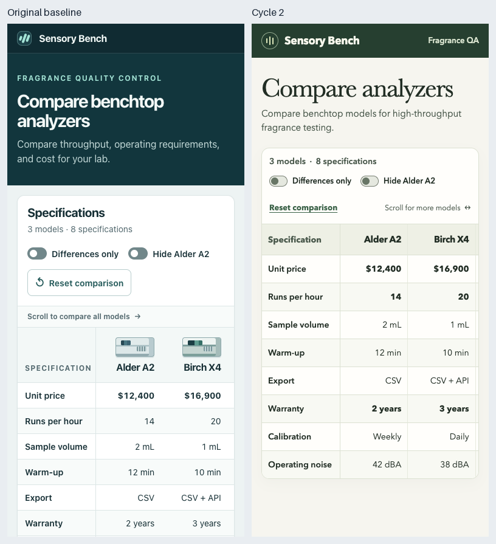
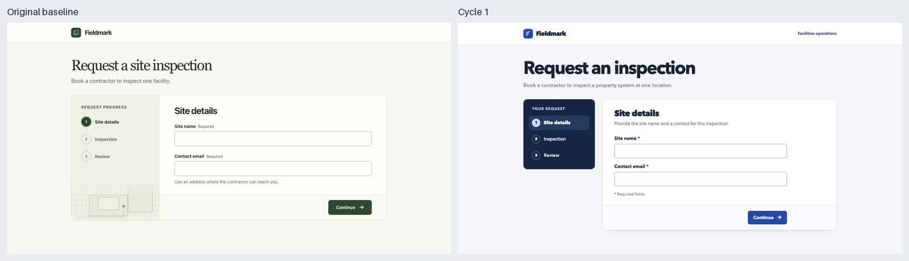
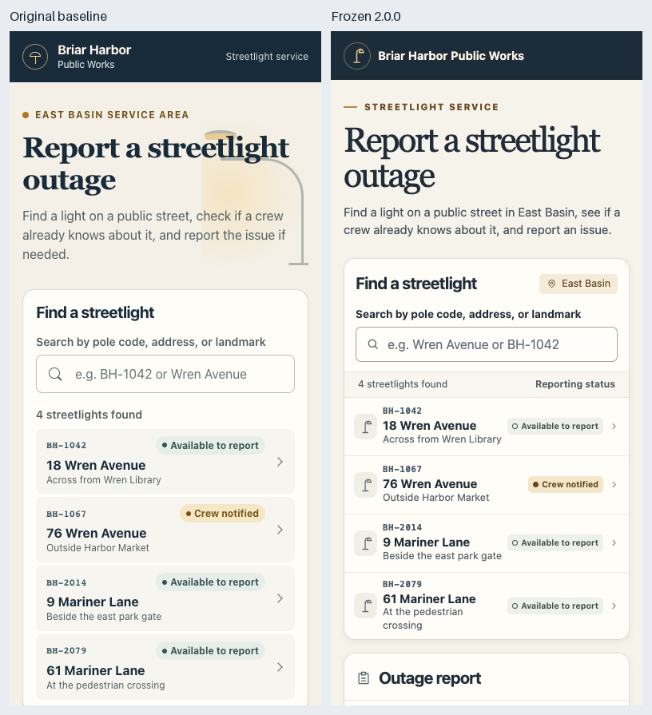

# UX Designer benchmark report

Cycle 2 is the prepared UX Designer 2.0.0 release. It won all six development comparisons against 1.0.0 and raised the matched mean by 5.67 points. On three held-out tasks it raised the mean by 2.67 points and won two design preferences. Confirmation was mixed. One clean workflow improved, one clean workflow lost the preference, and both scheduling implementations had a serious accessibility issue. The selected source remains exactly the version frozen before opening confirmation.

## Scorecard

| Revision | Mean score | Change vs baseline | Pairwise wins–losses–ties | Functional regressions | Decision |
|---|---:|---:|---:|---:|---|
| Baseline (Cycle 1 panel) | 86.17 | — | — | — | Reference |
| Cycle 1 | 88.00 | +1.83 | 4–2–0 | 0 | Advanced |
| Cycle 2 | 88.83 | +5.67 | 6–0–0 | 0 | Selected |
| Cycle 3 | 87.83 | +2.33 | 4–2–0 | 0 | Rejected |
| Cycle 4 | 88.33 | +5.17 | 6–0–0 | 0 | Rejected |
| Final confirmation | 84.67 | +2.67 | 2–1–0 | 0 | Partial transfer, shared accessibility blocker |

The development scorecard compares each candidate against the original output as graded in that panel. The same baseline scored 86.17, 83.17, 85.50 and 83.17 across the four development panels. The held-out baseline mean was 82.00 on new outputs and tasks. The table includes design scores for both scheduling versions and records their shared blocker separately.

## What changed

The 1.0.0 skill already taught visual hierarchy, repeated scales, tabular numerals, defensive layout and browser verification. The six baseline implementations were working interfaces, and several showed strong product-specific choices. The study tested whether moving the skill's guidance closer to the user's decision and the actual rendered screen could improve that starting point.

The authors' public material gave the audit three useful distinctions. Label emphasis depends on what the user scans for, so a spec heading or form label can deserve as much care as its value. Line height depends on the size and measure of the text, which gives a better rule for body text and display type than a single leading value. Dense layouts can deliberately use less space where comparison depends on seeing more information together. The reference audit maps each chapter family to specific baseline omissions and the revision that addresses them. It draws on the public inventory, excerpts and published examples. [Coverage audit](SOURCE-AUDIT.md)

The first revision shortened the main workflow and added detail through references. It starts with the feature and its actual data, sets an appropriate visual direction, explains when to use depth and imagery, and asks the agent to inspect the working layout and make a visible correction. It distinguishes build, refinement, critique and system handoff through the work the user requests. It preserves the previous asset paths, adds Tailwind v4 CSS aliases and moves the sample prototype styling to an opt-in region. The token checks found 13 original contrast failures among the text and status combinations on common background surfaces. The revised asset passes 29 declared pairs, including new status surfaces, control boundaries and focus roles.

## Study design

The original source archive comes from the project worktree's starting commit `539f73b`. The existing local `main` was divergent and lacked the repository policy and version metadata. Its UX skill contents differed from the frozen versioned baseline only in that metadata. The separate worktree preserved the local commit and unrelated untracked files. The frozen skill had no per-skill README. The new README covers use and migration. The previous benchmark branch measured several agent-authored design-spec qualities. This study uses the actual interface and the six requested design-task families as the unit of evaluation.

Fresh Codex agents implemented fixed synthetic briefs with identical grouping and no model override. Each group handled up to two development tasks. They received the skill, exact brief, a clean directory or original starter, and the same implementation prompt. They built sites that run locally. The Playwright harness used the same pinned Chromium and axe versions and fresh contexts to capture screenshots and run task assertions. Four controls qualified the capture path, including an intentional product failure and a missing-source result.

Independent grading agents reviewed anonymous screenshots at desktop, tablet and mobile widths, post-action captures and redacted test results. They never wrote the skill or the test interfaces. Each task was scored within a blind panel using the 100-point rubric. When a panel included three revisions, the grader saw all three anonymous pairings in random order. The mean and median cover matched, gradeable tasks in that panel. Technical failures and grader blockers are reported separately from aesthetic judgments. [Protocol](PROTOCOL.md) · [Rubric](RUBRIC.md) · [Run manifest](evidence/manifest.json)

One separate agent authored and sealed three confirmation tasks before development outcomes were used. The development workflow received the digest and counts. These tasks were reserved until the selected snapshot was frozen.

## Development outcomes

**Cycle 1** tested the feature-first redesign and the shorter workflow. It won four of six against 1.0.0 at a mean of 88.00 versus 86.17. The landing page tied the visual to the assortment evidence, the pricing dashboard freed the width used by a single-item sidebar, and the dispatch queue surfaced the late-stop count. The form lost six points where a dark progress block and heavy type competed with the fields. The typography score fell by 0.83 points across the set. The candidate advanced on preference and passed all browser suites. [Cycle 1 experiment](evidence/cycle-1.md)

**Cycle 2** targeted that over-emphasis through a rendered type audit and more deliberate roles for page titles, labels and controls. The form improved nine points over Cycle 1 in its blind panel. The comparison showed all eight specification rows within the first mobile viewport, and the landing page brought the evidence into view sooner. Cycle 2 won all six against the original baseline and four of six against Cycle 1. The typography gain against Cycle 1 was 0.33 points and it still scored slightly below the rescored baseline on typography. The selected skill includes these changes. [Cycle 2 experiment](evidence/cycle-2.md)

**Cycle 3** tested tighter placement of evidence and actions, especially after an interaction and at narrow widths. It improved the investigation cue, form composition and mobile queue against the leader. Its mean matched Cycle 2 and it won three of five non-tied comparisons. The comparison lost seven points when the illustrated model header crowded the mobile values, and documentation lost six. Those task-family regressions outweighed the preference count. [Cycle 3 experiment](evidence/cycle-3.md)

**Cycle 4** returned to the Cycle 2 source and tested removing or muting a competing element during visual review. An implementer found and repaired a collapsed table column in that process. The landing page, dashboard and dispatch queue improved against Cycle 2, while the comparison, form and documentation lost ground. The mean fell 0.83 points and the pair split was 3–3. The two successive non-improvements ended development after four cycles, with both rejected variants retained as evidence. [Cycle 4 experiment](evidence/cycle-4.md)

The table shows each task’s score change relative to the original baseline as scored inside that round. All 30 development trials passed the frozen browser checks.

| Task family | Cycle 1 | Cycle 2 | Cycle 3 | Cycle 4 |
|---|---:|---:|---:|---:|
| B2B landing page | +2 | +6 | −3 | +4 |
| Commercial intelligence dashboard | +7 | +7 | +9 | +8 |
| Product comparison | +4 | +9 | +3 | +5 |
| Multistep form | −6 | +2 | +2 | +1 |
| Existing dispatch queue refinement | +6 | +5 | +6 | +6 |
| Responsive documentation | −2 | +5 | −3 | +7 |

## Confirmation

| Reserved task | Baseline | Frozen 2.0.0 | Blind preference | Browser outcome |
|---|---:|---:|---|---|
| Briar Harbor streetlight reporting | 80 | 87 | 2.0.0, high confidence | Both pass |
| Switchyard Pantry artwork proofing | 87 | 85 | Baseline, medium confidence | Both pass |
| Bridgeglass studio bookings | 79 | 82 | 2.0.0, medium confidence | Both have the same accessibility blocker |

The new streetlight implementation transferred the hierarchy and responsive composition gains to public self-service. It kept the phone heading clear of the lamp illustration, aligned reporting status and grouped the existing report information. In proofing, the candidate's continuous canvas and registration marks worked well at large sizes. The baseline kept mobile job metadata and notes tighter, and its pin switch communicated state more clearly. In scheduling, all eight agenda rows fit the first phone viewport on the candidate, while the baseline kept time, date context and the legend more closely grouped. [Confirmation grades](evidence/panels/confirmation.grades.json) · [Held-out scorecard](evidence/panels/confirmation.summary.json)

All 18 held-out functional scenarios passed. On the scheduling task, axe flagged `label-content-name-mismatch` as serious on both versions at 1440, 834 and 390 CSS px. The supplemental Chromium readback showed why: both implementations override the booking button name with a string that reorders its visible components. The baseline also presents the phone time range differently. The scripted date, filter, conflict and move flows still work. The shared accessibility finding blocks acceptance of both scheduling implementations, so their visual preference is reported without treating that task as a successful accessible transfer. The skill was left frozen. [Original booking report](evidence/runs/confirmation/baseline/h3/browser/report.json) · [Selected booking report](evidence/runs/confirmation/cycle-2/h3/browser/report.json) · [Accessible-name readback](evidence/confirmation-booking-labels.json)

## Comparisons by dimension

A is hierarchy, B typography, C color/depth/composition, D identity, E usability/responsiveness and F implementation coherence. Values show the mean paired difference in points.

| Panel | Comparator | Median candidate / comparator | A | B | C | D | E | F |
|---|---|---:|---:|---:|---:|---:|---:|---:|
| Cycle 1 | Baseline | 88.5 / 86.0 | +1.00 | −0.83 | +0.33 | +1.00 | +0.33 | 0.00 |
| Cycle 2 | Baseline | 89.0 / 83.0 | +2.00 | −0.17 | +1.50 | +1.67 | +0.67 | 0.00 |
| Cycle 2 | Cycle 1 | 89.0 / 89.0 | +0.17 | +0.33 | +0.33 | +0.50 | +0.17 | −0.17 |
| Cycle 3 | Baseline | 89.0 / 86.5 | +1.33 | −0.33 | +0.33 | +0.83 | 0.00 | +0.17 |
| Cycle 3 | Cycle 2 | 89.0 / 88.0 | +0.17 | −0.50 | −0.17 | +0.33 | +0.17 | 0.00 |
| Cycle 4 | Baseline | 89.0 / 83.5 | +1.50 | +0.17 | +1.50 | +1.33 | +0.33 | +0.33 |
| Cycle 4 | Cycle 2 | 89.0 / 89.0 | +0.17 | −0.33 | −0.17 | −0.33 | −0.17 | 0.00 |
| Confirmation | Baseline | 85.0 / 80.0 | +0.33 | +0.33 | +1.33 | +1.00 | −0.67 | +0.33 |

The repeatable development gains were strongest in hierarchy, composition and identity. The comparison, dashboard and dispatch cases improved against the baseline under every candidate. Typography varied and the usability score fell on the held-out set. These differences are consistent with genuine gains in scanability for some tasks and a persistent gap in interactive and accessible details.

## Verification and execution

The campaign retained 36 implemented interfaces, 180 browser screenshots and 88 passing scripted scenarios. Thirty-four trials passed all automated checks. The two held-out scheduling trials failed the accessibility gate. Each trial preserves its initial accessibility scans and any inconclusive findings. Four controls qualified the runner. Evidence verification checked exact brief and source bytes, screenshot hashes and dimensions, snapshot hashes, grade receipts and the order of selection and confirmation reveal.

| Arm | Development mean seconds per two-task actor | Median browser seconds per development task |
|---|---:|---:|
| Baseline | 421.7 | 2.78 |
| Cycle 1 | 402.0 | 2.00 |
| Cycle 2 | 405.3 | 2.11 |
| Cycle 3 | 478.0 | 2.18 |
| Cycle 4 | 470.7 | 2.40 |

The confirmation groups contained two tasks and one task per arm. Mean elapsed time per group was 424.0 seconds for the baseline and 441.5 for the selected version, and median browser capture time was 2.45 seconds across those six trials. Actor-group durations include setup and handoff time and do not measure per-task token usage or costs. [Trial ledger](evidence/events.jsonl) · [Qualification](harness/qualification.json)

The selected skill passed the structural validator and repository release contract. Its asset bytes match the 29-pair contrast test, opt-in Chromium CSS scope test and Tailwind 4.3.3 alias compilation. The legacy JavaScript syntax check, nine archive-contract regression tests and local link review also passed.

## Limits on interpretation

Each arm produced one implementation per brief. Pairing limits task-mix effects, but the comparison cannot isolate changes in skill wording from normal variation in model outputs. Fresh judges saw the baseline again in later development panels, so a baseline mean can move even though the source and screenshots are identical. Scores are best read alongside the observed differences and task outcomes.

Automated accessibility checks cover the initial state at each width. The scenario screenshots and graders expose some interaction issues, and the retained source provides further context. The evidence leaves some focus sequences, scrolled states, chart disclosures and axe-incomplete findings unverified. One browser launch workaround was shared during self-verification for the same task group in the baseline and first candidate. The independent capture path stayed pinned. The service did not expose per-agent model revision, token usage or charges. Actor timing is available by group and browser latency by task.

## Rendered examples

**Sensory Bench, first 844 CSS px at 390 wide.** Cycle 2 compacted the header and filter area and removed the tall model art from the table head. All eight specifications appear vertically in the first viewport. The third comparison column is still reached through the scoped horizontal scroll. The grader preferred Cycle 2 to both earlier outputs for these concrete changes. [Baseline full screenshot](evidence/runs/development/baseline/d3/browser/mobile.png) · [Cycle 2 full screenshot](evidence/runs/development/cycle-2/d3/browser/mobile.png)

**Fieldmark, desktop first step.** Cycle 1 introduced a dark progress block and several very heavy text tiers. The form still passed the interaction suite, but the grader preferred the baseline's less competitive progress area and more coherent grouping. This loss informed the next typography and state treatment. [Baseline desktop](evidence/runs/development/baseline/d4/browser/desktop.png) · [Cycle 1 desktop](evidence/runs/development/cycle-1/d4/browser/desktop.png) · [Cycle 1 mobile error](evidence/runs/development/cycle-1/d4/browser/scenario-01-mobile-validation.png)

**Held-out streetlight service, first 844 CSS px at 390 wide.** The original lamp illustration overlaps the streetlight heading. The selected skill's output moves the ornament out of the phone view, aligns the report statuses, and reveals the report panel below the four selector rows sooner. The blind grader scored this case 87 versus 80. [Baseline full screenshot](evidence/runs/confirmation/baseline/h1/browser/mobile.png) · [Selected full screenshot](evidence/runs/confirmation/cycle-2/h1/browser/mobile.png)

## Next tests

- Evaluate whether rich native controls keep their visible labels intact in accessible names. Add label-in-name assertions for booking cards, then check keyboard and speech-control behavior. Use a new reserved task for any revised prompt.
- Add state captures and accessibility scans for horizontally scrolled comparisons, form review and focus return, and narrow approval or conflict dialogs.
- Repeat across multiple independent generations and fresh pairs in the weaker typography and proofing families. This would help distinguish the wording effects from single-generation and judge variation.
